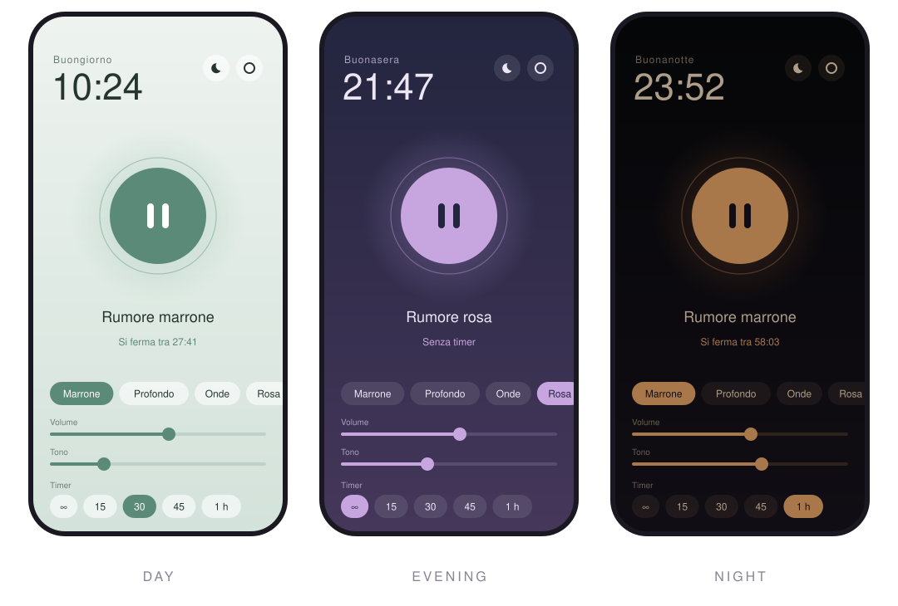

<p align="center">
  
</p>

<p align="center">
  <b>Un'app Android calma e minimale che riproduce rumore marrone per aiutarti a dormire.</b><br>
  Niente file audio, niente loop, niente internet, niente pubblicità. Solo rumore.
</p>

<p align="center">
  
  
  
  
</p>

<p align="center">
  <a href="README.md">🇬🇧 English</a> · 🇮🇹 Italiano
</p>

---

<p align="center">
  
</p>
<p align="center"><sub>L'interfaccia cambia in base all'orario (anteprima grafica).</sub></p>

## ✨ Funzioni

| | |
|---|---|
| 🌊 **Cinque rumori** | Marrone, Marrone profondo, Onde, Rosa, Bianco. Generati in tempo reale e in stereo, quindi non si sente mai un loop. |
| ⏳ **Timer** | Da 15 minuti a 2 ore, oppure senza limite. Con il tasto **+15 min** mentre suona. Alla fine il suono sfuma piano (da 10 secondi a 5 minuti). |
| 🌗 **Tema in base all'orario** | Verde salvia di giorno, indaco la sera, nero caldo e ambra di notte, con pochissima luce blu. |
| 🌑 **Schermo oscurato** | Di notte lo schermo si oscura da solo dopo 20 secondi senza tocchi. Resta solo un orologio tenue che si sposta un po' ogni minuto, per proteggere gli schermi OLED. |
| 🎚️ **Tono** | Da *naturale* a *ovattato*, con un filtro passa-basso. |
| 🔒 **A schermo spento** | Continua a suonare in background, con una notifica che mostra il conto alla rovescia e i comandi rapidi. |
| 🎧 **Audio intelligente** | Si ferma se scolleghi le cuffie, si abbassa durante le chiamate e, se vuoi, suona insieme a podcast o audiolibri. |
| 🫁 **Cerchio che respira** | Il cerchio centrale respira a circa 6 respiri al minuto, un ritmo spesso usato per rilassarsi. |

## 📥 Download

Scarica l'ultimo APK dalla pagina [**Releases**](../../releases/latest), aprilo sul telefono e consenti l'installazione da origini sconosciute.

Richiede **Android 8.0** (API 26) o superiore.

## 🛠️ Compilare dal codice

```bash
git clone <url-del-repository>
cd Quiete
./gradlew assembleRelease
```

Oppure apri la cartella in **Android Studio** e premi ▶ Run.

GitHub Actions compila anche ogni push su `main`. L'APK si scarica come artefatto dell'esecuzione.

## 🎛️ Come viene generato il suono

Il rumore viene sintetizzato campione per campione in un thread dedicato e inviato a un `AudioTrack` (44,1 kHz, stereo, float):

- **Bianco**: un generatore casuale xorshift.
- **Marrone**: integrazione "con perdita" del bianco, `y = (y + 0.02·x) / 1.02`, che dà una pendenza di −6 dB/ottava.
- **Marrone profondo**: marrone con un ulteriore filtro passa-basso a circa 280 Hz.
- **Rosa**: filtro di Paul Kellet (−3 dB/ottava).
- **Onde**: marrone modulato da due LFO lenti e sfasati, così le onde non si ripetono mai uguali.
- **Tono**: filtro passa-basso a un polo, con la frequenza di taglio che va da 18 kHz a 250 Hz su scala logaritmica.

Ogni canale ha il suo generatore, quindi l'immagine stereo è ampia e naturale. Tutte le variazioni di volume sono graduali, per evitare scatti.

## 🔐 Privacy

Quiete **non** chiede l'accesso a internet: non raccoglie né invia nulla. Usa solo i permessi per le notifiche e la riproduzione in background.

## 🗂️ Struttura

```
app/src/main/java/com/quiete/app/
├── NoiseEngine.kt     # sintesi del rumore in tempo reale
├── SleepPlayer.kt     # stato, timer, dissolvenze
├── NoiseService.kt    # servizio in primo piano, notifica, focus audio
├── Prefs.kt           # impostazioni salvate
├── MainActivity.kt
└── ui/
    ├── QuieteApp.kt   # interfaccia Compose
    └── Palette.kt     # palette giorno / sera / notte
```

<details>
<summary><b>Pubblicare release firmate (per chi mantiene il progetto)</b></summary>

<br>

Crea un tag come `v1.0.0` e fai il push: il workflow **Release** compila l'APK e lo allega a una nuova release su GitHub.

Per firmare le release sempre con la stessa chiave, così gli utenti possono aggiornare senza disinstallare:

1. Crea un keystore una volta sola:
   ```bash
   keytool -genkeypair -v -keystore release.jks -alias quiete -keyalg RSA -keysize 2048 -validity 10000
   ```
2. In *Settings → Secrets and variables → Actions* aggiungi:
   - `KEYSTORE_BASE64`: l'output di `base64 -w0 release.jks`
   - `KEYSTORE_PASSWORD`
   - `KEY_ALIAS` (es. `quiete`)
   - `KEY_PASSWORD`
3. Conserva `release.jks` al sicuro e **non** caricarlo mai nel repository.

Senza questi secret, l'APK viene firmato con una chiave di debug temporanea.

</details>

## 📄 Licenza

[MIT](LICENSE)
