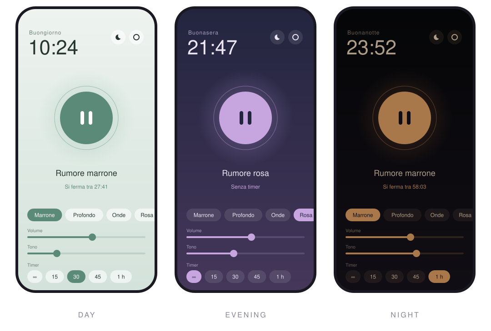

<p align="center">
  
</p>

<p align="center">
  <b>A calm, minimal Android app that plays brown noise to help you sleep.</b><br>
  No audio files, no loops, no internet, no ads. Just noise.
</p>

<p align="center">
  
  
  
  
</p>

<p align="center">
  🇬🇧 English · <a href="README.it.md">🇮🇹 Italiano</a>
</p>

---

<p align="center">
  
</p>
<p align="center"><sub>The interface adapts to the time of day (design preview).</sub></p>

## ✨ Features

| | |
|---|---|
| 🌊 **Five noises** | Brown, Deep brown, Waves, Pink, White. Generated live in stereo, so you never hear a loop. |
| ⏳ **Sleep timer** | 15 min to 2 h, or endless. Tap **+15 min** while it plays. The sound fades out gently at the end (10 s to 5 min). |
| 🌗 **Time-aware theme** | Soft sage by day, indigo in the evening, warm black and amber at night, with almost no blue light. |
| 🌑 **Blackout mode** | At night the screen dims itself after 20 s without touches, leaving only a faint clock that moves slightly every minute to protect OLED screens. |
| 🎚️ **Tone control** | Go from *natural* to *muffled* with a low-pass filter. |
| 🔒 **Screen-off playback** | Keeps playing in the background, with a notification showing the countdown and quick actions. |
| 🎧 **Smart audio** | Stops when headphones are unplugged, lowers the volume during calls, and can optionally play alongside podcasts or audiobooks. |
| 🫁 **Breathing orb** | The central circle breathes at about 6 breaths per minute, a pace often used for relaxation. |

## 📥 Download

Grab the latest APK from the [**Releases**](../../releases/latest) page, open it on your phone and allow installs from unknown sources.

Requires **Android 8.0** (API 26) or newer.

## 🛠️ Build from source

```bash
git clone <this-repo-url>
cd Quiete
./gradlew assembleRelease
```

Or open the folder in **Android Studio** and press ▶ Run.

Every push to `main` is also built by GitHub Actions. The APK is available as an artifact of the workflow run.

## 🎛️ How the sound is made

The noise is synthesized sample by sample in a background thread and streamed to an `AudioTrack` (44.1 kHz, stereo, float):

- **White**: a fast xorshift random generator.
- **Brown**: leaky integration of white noise, `y = (y + 0.02·x) / 1.02`, which gives a −6 dB/octave slope.
- **Deep brown**: brown noise with an extra low-pass filter at about 280 Hz.
- **Pink**: Paul Kellet's filter (−3 dB/octave).
- **Waves**: brown noise modulated by two slow, out-of-phase LFOs, so the waves never repeat in the same way.
- **Tone**: a one-pole low-pass filter whose cutoff moves on a log scale from 18 kHz down to 250 Hz.

Each channel has its own generator, so the stereo image feels wide and natural. All volume changes are smoothed to avoid clicks.

## 🔐 Privacy

Quiete does **not** request internet access. It collects nothing and sends nothing. The only permissions it uses are notifications and background playback.

## 🗂️ Project structure

```
app/src/main/java/com/quiete/app/
├── NoiseEngine.kt     # real-time noise synthesis (DSP)
├── SleepPlayer.kt     # playback state, timer, fades
├── NoiseService.kt    # foreground service, notification, audio focus
├── Prefs.kt           # saved settings
├── MainActivity.kt
└── ui/
    ├── QuieteApp.kt   # Compose UI
    └── Palette.kt     # day / evening / night palettes
```

<details>
<summary><b>Publishing signed releases (for maintainers)</b></summary>

<br>

Push a tag such as `v1.0.0` and the **Release** workflow builds the APK and attaches it to a new GitHub release.

To sign releases with a stable key, so users can update without reinstalling:

1. Create a keystore once:
   ```bash
   keytool -genkeypair -v -keystore release.jks -alias quiete -keyalg RSA -keysize 2048 -validity 10000
   ```
2. In *Settings → Secrets and variables → Actions*, add:
   - `KEYSTORE_BASE64`: output of `base64 -w0 release.jks`
   - `KEYSTORE_PASSWORD`
   - `KEY_ALIAS` (e.g. `quiete`)
   - `KEY_PASSWORD`
3. Keep `release.jks` safe and **never** commit it.

Without these secrets, the APK is signed with a temporary debug key.

</details>

## 📄 License

[MIT](LICENSE)
